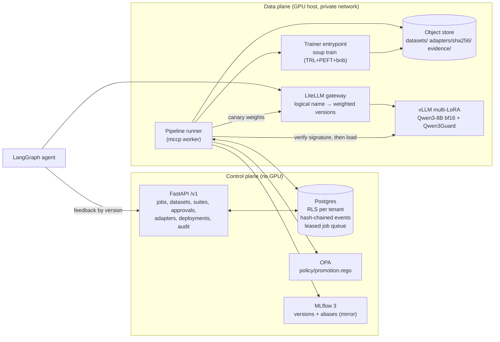

# MCCP: Enterprise Model Customization Control Plane

This is one governed path from an enterprise dataset to an agent. It replaces six separate training scripts.

```
dataset ─► Soup QLoRA SFT on Qwen3-8B ─► sign + register ─► publish guard ─► L1–L6 eval on the served adapter
        ─► OPA gate (staging) ─► human approval ─► OPA gate (production) ─► canary 90/10 ─► champion ─► agent
```

Phase 1 implements SFT with QLoRA. DPO and GRPO are reserved `method` values. The API already rejects them with a clear "Phase 2" error, and the schema, lineage and feedback store are in place for them.

## Architecture



| Layer | Module | Notes |
|---|---|---|
| Domain | `mccp.domain` | State machine (19 lifecycle states, OpenAI-compatible `status` derived from them), strict refs, recipes, job spec, canonical hashing. No I/O. |
| Data | `mccp.datasets` | Schema check → PII redaction → dedup (exact + MinHash) → group split by source → 13-gram decontamination of inputs → think-tag check → Soup `chatml` export. A residual PII scan must find nothing left. |
| Training | `mccp.training`, `trainer/` | Converts the resolved config into a Soup YAML, then runs the trainer as a supervised process. Pre-flight pins the model revision, checks the chat-template SHA, and checks that the pre-rendered tool block equals the native template's tokens. Rows over p99 length are rejected. |
| Registry | `mccp.registry` | Only the PEFT files are published. Each adapter is content-addressed and signed with OpenSSF model-signing. The attested per-file digests must match the manifest. MLflow mirrors versions and aliases. |
| Eval | `mccp.evals` | L0 publish guard: module allowlist per pinned vLLM, rank limit, live load, and an observable-effect probe. Then L1 task (JSON validity, field accuracy, tool-call parse rate, leaks into content), L2 position-swapped judge, L3 lm-eval regression, L4 Qwen3Guard safety, over-refusal and PII probes, L6 TTFT. |
| Governance | `mccp.governance`, `policy/` | Evidence bundle with a CycloneDX 1.6 ML-BOM, model card and compute record (6ND FLOPs). Rego thresholds are set per target and risk tier. The submitter cannot approve their own adapter. |
| Serving | `mccp.serving` | Fleet profile, a private vLLM admin client, and LiteLLM deployment weights for canary, promotion and rollback. |
| Workflow | `mccp.pipeline` | Durable runner. Postgres leasing (`FOR UPDATE SKIP LOCKED`), heartbeats, backoff, idempotent stages, and the audit event committed in the same transaction as each transition. |
| Transport | `mccp.api`, `mccp.cli` | OIDC (Entra) or dev JWT, RFC 9457 problem+json errors, `Idempotency-Key` on job submit. |

### Decisions that differ from a naive pipeline

- **Register before evaluate.** QLoRA trains on an NF4 base, but vLLM serves on bf16. Evaluation scores exactly what vLLM serves.
- **Publish guard.** vLLM silently skips adapter modules it does not support (vllm#38085). The guard checks against a pinned allowlist and runs a live effect probe. A no-op adapter is blocked from production.
- **Postgres is the source of truth for governance state.** MLflow is a mirror. Every state change and its audit event commit together.
- **Soup has no `revision` field and no explicit validation file.** The trainer downloads the pinned revision itself. Validation rows are appended to the training file, with `val_split` chosen so Soup's split lands exactly on the boundary (this is tested).
- **Soup's `chatml` format drops a `tools` column.** The tool schema is therefore pre-rendered into the system turn using the Qwen3 hermes format. Pre-flight proves this is token-identical to the native template, or the job fails.

## Quick start (laptop, rehearsal backend, no GPU)

```bash
uv sync
export MCCP_AUTH_MODE=dev MCCP_DEV_JWT_SECRET=$(openssl rand -hex 32)
uv run mccp db bootstrap --admin-dsn postgresql://postgres@127.0.0.1/postgres
uv run mccp db migrate
uv run mccp keys generate --out-dir secrets
uv run mccp tenant create acme --idp-tenant-id acme-tid
opa run --server policy/ &                      # OPA 1.x
export MCCP_TRAINER_BACKEND=rehearsal MCCP_SIGNING_PRIVATE_KEY_PATH=secrets/signing-key.pem \
       MCCP_SIGNING_PUBLIC_KEY_PATH=secrets/signing-pub.pem MCCP_OBJECT_STORE_URL=file://$PWD/.data/objects \
       MCCP_WORK_DIR=$PWD/.data/work MCCP_VLLM_LORA_ROOT=$PWD/.data/lora MCCP_FLEET_PROFILE_PATH=deploy/fleet.yaml
uv run mccp api &                                # :8080
```

The rehearsal backend writes a valid no-op adapter. It exercises every stage, and the production gate refuses it by design.

## Topologies

**Single GPU host:** run `deploy/compose.yaml`. Everything runs on one machine, the object store is a shared Docker volume, and one worker serves all three lanes.

**Split (VPS + GPU host):** the control plane runs on a CPU-only VPS and the training and serving plane on a GPU host. They share state through Postgres, an S3-compatible bucket and MLflow, over a private network (WireGuard or Tailscale).

| Host | Compose file | Runs | Holds |
|---|---|---|---|
| VPS | `deploy/vps/compose.vps.yaml` (installed by `deploy/vps/install.sh`) | Postgres, MinIO (S3), OPA, MLflow, API, controller (`control` lane) | Signing **public** key only |
| GPU host | `deploy/gpu/compose.gpu.yaml` | worker (`gpu` and `serving` lanes), vLLM, Qwen3Guard, LiteLLM | Signing **private** key |

### Work lanes

Each pipeline stage belongs to a lane: `gpu` (data staging → training → registration), `serving` (publish guard, eval, canary, rollback), or `control` (validation, policy gates, approvals). A worker serves the lanes in `MCCP_WORKER_LANES`, with concurrent slots per lane (`MCCP_WORKER_SLOTS_*`). When a job's next stage is in a different lane, it is handed to a worker for that lane, so a long training run never delays another job's approval or canary.

### VPS install

```bash
mkdir -p /opt/mccp && cd /opt/mccp && unzip -q -o ~/mccp-control-plane.zip && cd mccp-py && bash deploy/vps/install.sh
```

The installer is idempotent. It generates secrets once and adds any missing ones on upgrade. It creates the bucket and the first tenant, writes 24-hour dev tokens for three separate users, and optionally adds a `/mccp` Caddy route.

Postgres, S3 and MLflow bind to `MCCP_PRIVATE_BIND`. Their host ports (`MCCP_PG_PORT`, `MCCP_S3_PORT`, `MCCP_MLFLOW_PORT`, plus `MCCP_API_PORT` for the API) are picked once as the first free port at or above the defaults (55432, 59000, 55055, 8195) and kept in `deploy/vps/.env`. Leave it at `127.0.0.1` until the private network exists, then set it to the VPS's private address. **Never bind them to a public interface: these links are not TLS-protected yet.**

### GPU host

```bash
cp deploy/gpu/.env.example deploy/gpu/.env      # VPS private address + secrets from deploy/vps/.env
uv run mccp keys generate --out-dir deploy/gpu/secrets
# copy deploy/gpu/secrets/signing-pub.pem to the VPS at deploy/vps/secrets/signing-pub.pem, then re-run the VPS installer
docker compose -f deploy/gpu/compose.gpu.yaml --env-file deploy/gpu/.env up -d --build
```

Until the VPS has the public key, the policy gate denies every promotion (`adapter_verified=false`). This is deliberate: an unverified adapter can never be promoted.

## Real run (GPU host)

1. `cp deploy/.env.example deploy/.env`, then fill in the secrets, `QWEN3_8B_REVISION` and the OIDC settings.
2. `uv run mccp keys generate --out-dir deploy/secrets`
3. `docker compose -f deploy/compose.yaml --env-file deploy/.env up -d --build` starts Postgres, the migration job, OPA, MLflow, vLLM (Qwen3-8B and Qwen3Guard), LiteLLM, the API and the GPU worker.
4. Onboard a tenant: `docker compose exec api mccp tenant create acme --idp-tenant-id <entra tid>`
5. As the Entra roles `Customizer.Admin`, `Customizer.Submit` and `Customizer.Approve`:

```bash
export MCCP_API_URL=http://localhost:8080 MCCP_TOKEN=<token>
mccp recipe-put examples/recipe-qwen3-8b-qlora-sft.yaml        # after pinning revision + template SHA
mccp examples invoices --n 3000                                   # or your own messages JSONL
mccp dataset-upload finance-ops invoice-exceptions examples/out/invoices.jsonl
mccp suite-create finance-ops examples/suite-invoice-triage.yaml
mccp job submit examples/job-invoice-triage.yaml
mccp job watch <job-id>                                           # stops at pending_approval
mccp approvals                                                    # approver: review evidence + model card
mccp approve <job-id> "Evidence reviewed, within thresholds"      # different person than submitter
python -m mccp.agent.graph --model finance-ops.invoice-triage --n 10 --feedback
mccp rollback finance-ops invoice-triage "reason"                 # if needed
mccp audit-verify
```

**Input format:** one JSON object per line, containing `messages` (system/user/assistant/tool, with optional `tool_calls`), optional `tools`, and `meta.source_id`. `meta.source_id` is the grouping key for leakage-free splits.

## Tests

```bash
uv run pytest                     # 162 tests; DB/OPA/S3 (moto) tests skip if unavailable
MCCP_TEST_ADMIN_DSN=postgresql://postgres@127.0.0.1/postgres MCCP_TEST_OPA_BIN=$(which opa) uv run pytest
MCCP_TEST_SOUP_PYTHON=/path/to/venv-with-soup/bin/python uv run pytest tests/test_soup_contract.py
```

The end-to-end tests run against real Postgres and a real OPA binary. vLLM, LiteLLM and MLflow are an in-process fake that simulates good, unsafe, leaky and no-op adapters. The tests cover:

- The full vertical: promote, supersede, roll back, and verify the audit chain.
- Gate rejections: an unsafe adapter, tool-call leaks (the vllm#42021 symptom), and modules vLLM would skip.
- Approver reject and the self-approval block.
- Cancel, idempotency under 20 concurrent submits, and cross-tenant isolation.
- Problem+json errors.

## Verified on a GPU (2026-11-01)

The single-GPU pilot (`deploy/gpu/pilot.py`, `deploy/gpu/run_pilot.sh`) ran the real path on an RTX 4000 Ada (20 GB). Details, numbers and host notes are in [docs/gpu-pilot-2026-11-01.md](docs/gpu-pilot-2026-11-01.md).

- **A real `soup train` QLoRA run on Qwen3-8B** at the pinned revision, including both pre-flight render-checks against the real Qwen3 tokenizer.
- **vLLM v0.29 runtime LoRA loading, the hermes tool parser and `--default-chat-template-kwargs`** (pip install, not the container image).
- **L0 publish guard and L1 evaluation on the served adapter.** After the two fixes below, the adapter scored task 0.89 (95% CI 0.84-0.94) vs 0.01 for the base, with 100% exact tool calls and 100% valid JSON.

The pilot found and fixed two bugs the fakes could not: eval requests vLLM rejects (tool calls without ids) and padded `null` tool arguments in training data (Arrow struct unification). Both have regression tests.

## Model profiles

Base models are switchable: a recipe names a profile (`profiles/<id>@v<N>.yaml`) that holds the model's tool rendering, reasoning switch, vLLM parsers, LoRA modules, license and country of origin. `qwen3-8b@v1` and `granite-3.3-8b-instruct@v1` (US origin) are validated; new profiles are drafts until `mccp profile validate` proves their rendering on the real tokenizer (CPU only). Tenants can restrict base-model origins (`mccp tenant set-origins`), enforced by the promotion policy. See [docs/model-profiles.md](docs/model-profiles.md).

## Benchmark kit

`deploy/gpu/run_batch.sh` runs a multi-seed batch and scores each adapter on the held-out split and an out-of-distribution set, against the base model and optionally a prompted frontier model, with latency and cost per 1,000 decisions. On a GPU box, `mccp-gpu up --queue <profile>` (one `curl | bash` line) sets the box up, asks once for the baseline key, and runs queued batches in the background; `mccp-gpu status` / `results` show progress and tables. See [docs/benchmark.md](docs/benchmark.md).

## Rationale-Guided Training (RGT)

`--methods rgt` adds a strategy-explicit copy of every decision sample (the rule chain for that invoice, plus the base model's actual mistake), rendered in the model's own reasoning block and verified against the real chat template before training. `mccp-gpu queue add qwen3-8b@v1 --n 100,300,1000 --methods sft,rgt --seeds 42 --test-n 300` runs the SFT-vs-RGT learning curve on one fixed test set and writes `curve.md`. See [docs/rgt.md](docs/rgt.md).

## Still not verified

- **The Docker topologies** (`deploy/compose.yaml`, `deploy/gpu/compose.gpu.yaml`): container image tags (vLLM, MLflow, LiteLLM, OPA), the worker image build, and the 48 GB serving GPU they assume. The pilot ran from venvs, not images.
- **Decision accuracy at the recipe defaults.** The pilot used 1 epoch on 400 records; run the full 3,000-record, 2-epoch job before quoting accuracy.
- **Dependency drift.** The Soup 0.72.4 extras pin `trl<0.25` and `transformers<5`. That is why the worker image keeps its trainer venv separate from the control plane. The trainer environment is hash-locked in `trainer/requirements.lock.txt`.
- **LiteLLM behaviour.** Keeping the custom `model_info.id`, forwarding `extra_body`, model access groups, and `/key/generate` for `mccp gateway-key` all need confirming against a real LiteLLM.
- **Granite on a GPU.** The profile is validated on its tokenizer; training and serving it needs one GPU batch (`PROFILE=granite-3.3-8b-instruct@v1`).
- **L2-L6 layers on real hardware** (judge, lm-eval regression, Qwen3Guard safety, TTFT). The fleet allowlist for `qwen3_5` is a placeholder until M7.
- **MinIO.** MinIO stopped publishing maintained community images in late 2025. Pin `MINIO_IMAGE` to a digest you have vetted, or use AWS S3 or another S3-compatible service.

## Phase 2 (DPO, then GRPO)

The extension points already exist:

- `method.type` is `dpo` or `grpo`, gated by `check_method_enabled`.
- The `feedback` table is keyed by concrete adapter version.
- The `parent_adapter` lineage slot is in the adapter card.
- The invoice `decide()` function doubles as a verifiable GRPO reward.

Soup already supports DPO, KTO, GRPO and its variants in the same YAML. Phase 2 needs:

1. A preference-dataset builder from feedback.
2. A reward-function registry with tests.
3. Method-specific recipe defaults.
4. Phase 2 eval add-ons (win rate vs the SFT parent, reward-hacking checks).
