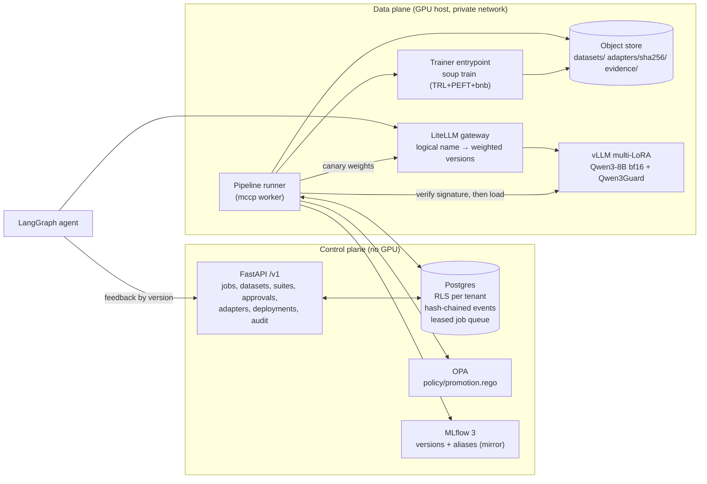

# MCCP: Enterprise Model Customization Control Plane

This is one governed path from an enterprise dataset to an agent. It replaces six separate training scripts.

```
dataset ─► Soup QLoRA SFT on Qwen3-8B ─► sign + register ─► publish guard ─► L1–L6 eval on the served adapter
        ─► OPA gate (staging) ─► human approval ─► OPA gate (production) ─► canary 90/10 ─► champion ─► agent
```

Phase 1 implements SFT with QLoRA. DPO and GRPO are reserved `method` values. The API already rejects them with a clear "Phase 2" error, and the schema, lineage and feedback store are in place for them.

## Architecture



| Layer | Module | Notes |
|---|---|---|
| Domain | `mccp.domain` | State machine (19 lifecycle states, OpenAI-compatible `status` derived from them), strict refs, recipes, job spec, canonical hashing. No I/O. |
| Data | `mccp.datasets` | Schema check → PII redaction → dedup (exact + MinHash) → group split by source → 13-gram decontamination of inputs → think-tag check → Soup `chatml` export. A residual PII scan must find nothing left. |
| Training | `mccp.training`, `trainer/` | Converts the resolved config into a Soup YAML, then runs the trainer as a supervised process. Pre-flight pins the model revision, checks the chat-template SHA, and checks that the pre-rendered tool block equals the native template's tokens. Rows over p99 length are rejected. |
| Registry | `mccp.registry` | Only the PEFT files are published. Each adapter is content-addressed and signed with OpenSSF model-signing. The attested per-file digests must match the manifest. MLflow mirrors versions and aliases. |
| Eval | `mccp.evals` | L0 publish guard: module allowlist per pinned vLLM, rank limit, live load, and an observable-effect probe. Then L1 task (JSON validity, field accuracy, tool-call parse rate, leaks into content), L2 position-swapped judge, L3 lm-eval regression, L4 Qwen3Guard safety, over-refusal and PII probes, L6 TTFT. |
| Governance | `mccp.governance`, `policy/` | Evidence bundle with a CycloneDX 1.6 ML-BOM, model card and compute record (6ND FLOPs). Rego thresholds are set per target and risk tier. The submitter cannot approve their own adapter. |
| Serving | `mccp.serving` | Fleet profile, a private vLLM admin client, and LiteLLM deployment weights for canary, promotion and rollback. |
| Workflow | `mccp.pipeline` | Durable runner. Postgres leasing (`FOR UPDATE SKIP LOCKED`), heartbeats, backoff, idempotent stages, and the audit event committed in the same transaction as each transition. |
| Transport | `mccp.api`, `mccp.cli` | OIDC (Entra) or dev JWT, RFC 9457 problem+json errors, `Idempotency-Key` on job submit. |

### Decisions that differ from a naive pipeline

- **Register before evaluate.** QLoRA trains on an NF4 base, but vLLM serves on bf16. Evaluation scores exactly what vLLM serves.
- **Publish guard.** vLLM silently skips adapter modules it does not support (vllm#38085). The guard checks against a pinned allowlist and runs a live effect probe. A no-op adapter is blocked from production.
- **Postgres is the source of truth for governance state.** MLflow is a mirror. Every state change and its audit event commit together.
- **Soup has no `revision` field and no explicit validation file.** The trainer downloads the pinned revision itself. Validation rows are appended to the training file, with `val_split` chosen so Soup's split lands exactly on the boundary (this is tested).
- **Soup's `chatml` format drops a `tools` column.** The tool schema is therefore pre-rendered into the system turn using the Qwen3 hermes format. Pre-flight proves this is token-identical to the native template, or the job fails.

## Quick start (laptop, rehearsal backend, no GPU)

```bash
uv sync
export MCCP_AUTH_MODE=dev MCCP_DEV_JWT_SECRET=$(openssl rand -hex 32)
uv run mccp db bootstrap --admin-dsn postgresql://postgres@127.0.0.1/postgres
uv run mccp db migrate
uv run mccp keys generate --out-dir secrets
uv run mccp tenant create acme --idp-tenant-id acme-tid
opa run --server policy/ &                      # OPA 1.x
export MCCP_TRAINER_BACKEND=rehearsal MCCP_SIGNING_PRIVATE_KEY_PATH=secrets/signing-key.pem \
       MCCP_SIGNING_PUBLIC_KEY_PATH=secrets/signing-pub.pem MCCP_OBJECT_STORE_URL=file://$PWD/.data/objects \
       MCCP_WORK_DIR=$PWD/.data/work MCCP_VLLM_LORA_ROOT=$PWD/.data/lora MCCP_FLEET_PROFILE_PATH=deploy/fleet.yaml
uv run mccp api &                                # :8080
```

The rehearsal backend writes a valid no-op adapter. It exercises every stage, and the production gate refuses it by design.

## VPS control plane (CPU-only host, e.g. srv1507394)

`deploy/vps/install.sh` brings up Postgres, the migration job, OPA, MLflow and the MCCP API on a CPU-only box. The API listens on 127.0.0.1:8095. The script also adds an optional Caddy route `https://<site>/mccp/*`. It generates every secret and the signing keypair once, creates the first tenant, and writes 24-hour tokens for three separate demo users (admin, submitter, approver).

```bash
mkdir -p /opt/mccp && cd /opt/mccp && unzip -q -o ~/mccp-control-plane.zip && cd mccp-py && bash deploy/vps/install.sh
```

Re-running it upgrades the code and keeps the generated secrets. Training and serving need a GPU: run `deploy/compose.yaml` (worker, Soup trainer, vLLM, LiteLLM) on a GPU host. Point that worker's `MCCP_DATABASE_URL` at this Postgres, with `MCCP_PG_BIND` set to a firewalled private address. Then set `MCCP_VLLM_BASE_URL` in `deploy/vps/.env`.

## Real run (GPU host)

1. `cp deploy/.env.example deploy/.env`, then fill in the secrets, `QWEN3_8B_REVISION` and the OIDC settings.
2. `uv run mccp keys generate --out-dir deploy/secrets`
3. `docker compose -f deploy/compose.yaml --env-file deploy/.env up -d --build` starts Postgres, the migration job, OPA, MLflow, vLLM (Qwen3-8B and Qwen3Guard), LiteLLM, the API and the GPU worker.
4. Onboard a tenant: `docker compose exec api mccp tenant create acme --idp-tenant-id <entra tid>`
5. As the Entra roles `Customizer.Admin`, `Customizer.Submit` and `Customizer.Approve`:

```bash
export MCCP_API_URL=http://localhost:8080 MCCP_TOKEN=<token>
mccp recipe-put examples/recipe-qwen3-8b-qlora-sft.yaml        # after pinning revision + template SHA
mccp examples invoices --n 3000                                   # or your own messages JSONL
mccp dataset-upload finance-ops invoice-exceptions examples/out/invoices.jsonl
mccp suite-create finance-ops examples/suite-invoice-triage.yaml
mccp job submit examples/job-invoice-triage.yaml
mccp job watch <job-id>                                           # stops at pending_approval
mccp approvals                                                    # approver: review evidence + model card
mccp approve <job-id> "Evidence reviewed, within thresholds"      # different person than submitter
python -m mccp.agent.graph --model finance-ops.invoice-triage --n 10 --feedback
mccp rollback finance-ops invoice-triage "reason"                 # if needed
mccp audit-verify
```

**Input format:** one JSON object per line, containing `messages` (system/user/assistant/tool, with optional `tool_calls`), optional `tools`, and `meta.source_id`. `meta.source_id` is the grouping key for leakage-free splits.

## Tests

```bash
uv run pytest                     # 104 tests; DB/OPA tests skip if unavailable
MCCP_TEST_ADMIN_DSN=postgresql://postgres@127.0.0.1/postgres MCCP_TEST_OPA_BIN=$(which opa) uv run pytest
MCCP_TEST_SOUP_PYTHON=/path/to/venv-with-soup/bin/python uv run pytest tests/test_soup_contract.py
```

The end-to-end tests run against real Postgres and a real OPA binary. vLLM, LiteLLM and MLflow are an in-process fake that simulates good, unsafe, leaky and no-op adapters. The tests cover:

- The full vertical: promote, supersede, roll back, and verify the audit chain.
- Gate rejections: an unsafe adapter, tool-call leaks (the vllm#42021 symptom), and modules vLLM would skip.
- Approver reject and the self-approval block.
- Cancel, idempotency under 20 concurrent submits, and cross-tenant isolation.
- Problem+json errors.

## Not verified in the build sandbox

The sandbox had no GPU and no Hugging Face access. Before relying on this, validate on your GPU host:

- **A real `soup train` run on Qwen3-8B.** The Soup config and data pass Soup 0.72.4's own schema and converters in the contract test, but no real training has run.
- **The pre-flight render-check against the real Qwen3 tokenizer.** It is the gate for the tools pre-rendering decision.
- **vLLM v0.29 image flags, runtime LoRA loading, and the hermes tool parser on your adapters.** The fleet allowlist for `qwen3_5` is a placeholder until M7.
- **Container image tags in `deploy/compose.yaml`** (vLLM, MLflow, LiteLLM, OPA). These are pins to confirm, not tested builds.
- **Dependency drift.** The Soup 0.72.4 extras pin `trl<0.25` and `transformers<5`. That is why the worker image keeps its trainer venv separate from the control plane.

## Phase 2 (DPO, then GRPO)

The extension points already exist:

- `method.type` is `dpo` or `grpo`, gated by `check_method_enabled`.
- The `feedback` table is keyed by concrete adapter version.
- The `parent_adapter` lineage slot is in the adapter card.
- The invoice `decide()` function doubles as a verifiable GRPO reward.

Soup already supports DPO, KTO, GRPO and its variants in the same YAML. Phase 2 needs:

1. A preference-dataset builder from feedback.
2. A reward-function registry with tests.
3. Method-specific recipe defaults.
4. Phase 2 eval add-ons (win rate vs the SFT parent, reward-hacking checks).
